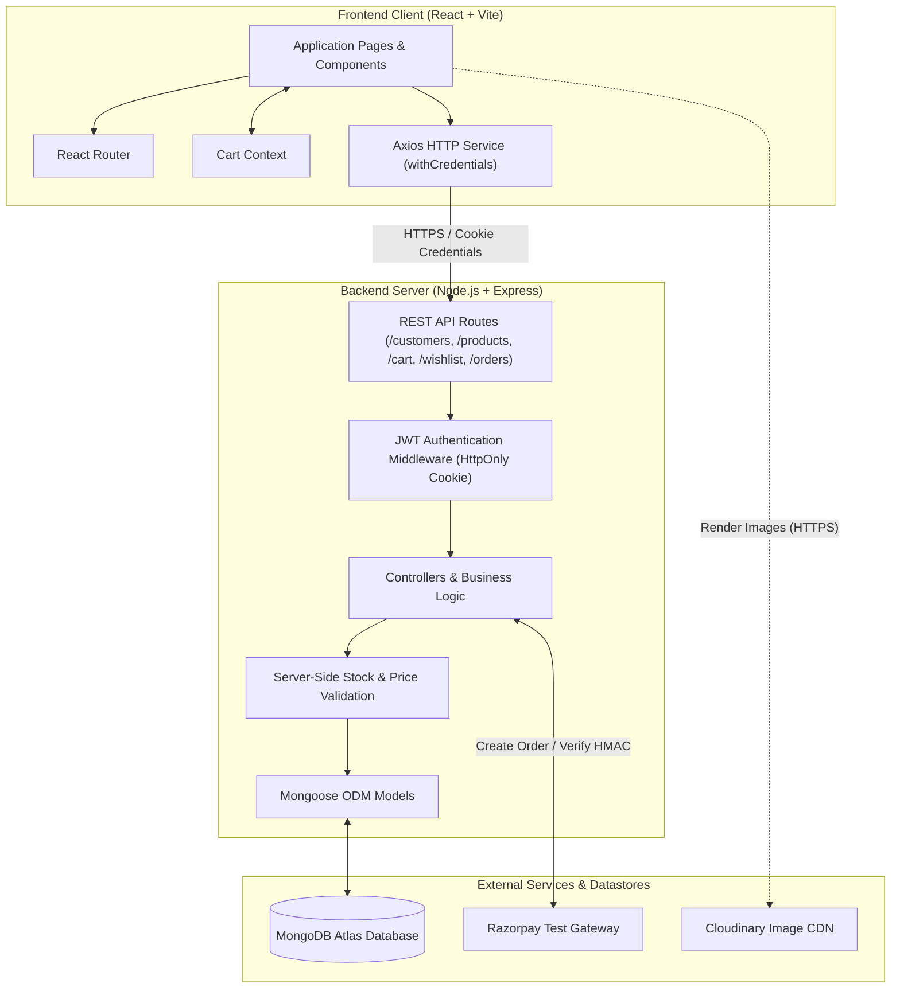
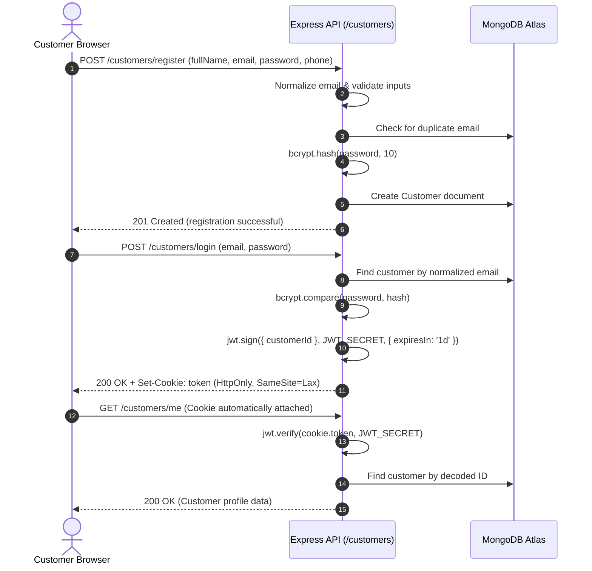
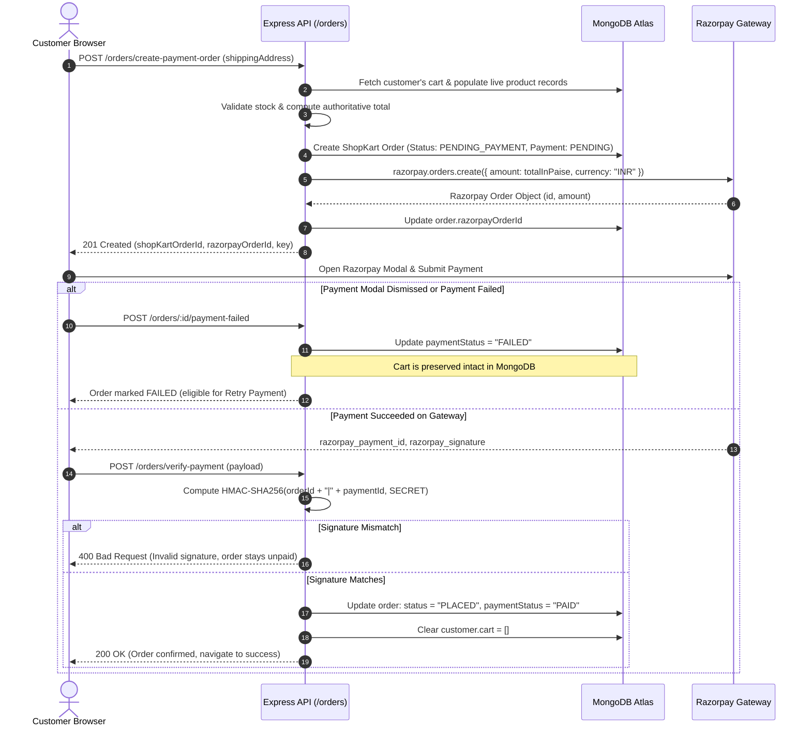

# ShopKart - Full-Stack E-Commerce Web Application

ShopKart is a modern, responsive, full-stack e-commerce web platform engineered for seamless online shopping, secure customer authentication, dynamic inventory browsing, persistent cart and wishlist management, and verified online payments via Razorpay (Test Mode).

This repository contains the complete implementation developed and consolidated across **Labs 01 through 06**, featuring production-grade security patterns, customer authorization barriers, server-validated order snapshots, and real-time payment retry capabilities.

---

## Table of Contents

- [Project Overview](#project-overview)
- [Key Features](#key-features)
- [Technology Stack](#technology-stack)
- [System Architecture](#system-architecture)
- [Application Flows](#application-flows)
  - [1. Authentication Flow](#1-authentication-flow)
  - [2. Shopping, Checkout & Payment Flow](#2-shopping-checkout--payment-flow)
- [Project Directory Structure](#project-directory-structure)
- [Prerequisites](#prerequisites)
- [Local Installation & Setup](#local-installation--setup)
- [Environment Variable Reference](#environment-variable-reference)
- [API Endpoint Documentation](#api-endpoint-documentation)
- [Security Practices](#security-practices)
- [Testing & Troubleshooting](#testing--troubleshooting)
- [Limitations & Future Roadmap](#limitations--future-roadmap)

---

## Project Overview

ShopKart delivers a commercial-grade online retail experience with a cohesive design system, resilient transactional workflows, and end-to-end data integrity.

### Problems Solved
- **Client-Side Tampering Prevention**: Product prices, order totals, and stock limits are strictly computed and verified on the backend. Clients cannot inject custom prices or bypass stock constraints.
- **Accidental Cart Deletion**: In-flight checkouts preserve the customer's cart until cryptographic HMAC signature verification confirms successful payment.
- **Unpaid Order Handling**: Failed or interrupted transactions remain accessible under "My Orders" with precise status labels (`Pending payment` or `Payment failed`), allowing customers to retry payment without creating duplicate order records.
- **Credential Protection**: Customer credentials and session tokens are guarded using salted bcrypt password hashing and tamper-proof `HttpOnly` cookies.

### Scope of Labs 01–06
- **Lab 01**: Customer authentication, registration, schema modeling, and bcrypt password hashing.
- **Lab 02**: Product catalog modeling, category filtering, search queries, and Cloudinary CDN asset delivery.
- **Lab 03**: Customer wishlist management with real-time toggle states and relational ObjectId references.
- **Lab 04**: Shopping cart persistence with stock bounds checking and transactional quantity adjustments.
- **Lab 05**: Multi-field shipping address validation, order schema snapshots, and Razorpay Test Mode checkout order generation.
- **Lab 06**: Backend HMAC-SHA256 signature verification, post-payment cart clearing, order tracking, and payment retry workflows.

---

## Key Features

- **Customer Authentication**: Secure registration, email normalization, bcrypt password hashing, and login issuing signed JWTs via `HttpOnly` cookies.
- **Product Catalog**: Live search, category filtering, responsive product cards, stock indicators, and price formatting.
- **Product Details**: High-resolution Cloudinary imagery, real-time stock status, detailed descriptions, and instant Add-to-Cart / Add-to-Wishlist actions.
- **Customer Wishlist**: Relational item tracking allowing customers to bookmark favorite products with instant UI synchronization.
- **Persistent Shopping Cart**: Database-backed cart tied to authenticated customer sessions, featuring automated stock limit enforcement and quantity controls.
- **Validated Checkout**: Complete 6-point shipping address verification (phone format, postal code, street, city, state) before initiating payment.
- **Razorpay Test Mode Integration**: Secure server-side order creation and dynamic Razorpay modal checkout popup.
- **Cryptographic Payment Verification**: Backend HMAC-SHA256 verification of `razorpay_order_id` and `razorpay_payment_id` against `RAZORPAY_KEY_SECRET`.
- **Payment Retry Workflow**: Unpaid or failed orders can be retried directly from Order Details or My Orders without duplicating the underlying ShopKart order.
- **Order Tracking & Confirmation**: Order confirmation screen, order timeline cards, itemized cost breakdowns, and live order status badges.
- **Cloudinary CDN Integration**: High-availability CDN delivery for all product catalog imagery.

---

## Technology Stack

| Layer | Technologies | Role & Purpose |
|---|---|---|
| **Frontend** | React 19, Vite 8 | Single Page Application (SPA), lightning-fast development, optimized production bundling. |
| **Routing** | React Router 7 | Client-side declarative routing, protected routes, URL state parameters. |
| **Styling** | Vanilla CSS (Design System) | Bespoke, modern UI design tokens, responsive CSS grid, glassmorphism headers, mobile drawer. |
| **State Management** | React Context API | Global Cart Context synchronizing item counts, totals, and optimistic actions. |
| **HTTP Client** | Axios | Configured with `withCredentials: true` for automatic cookie transmission and centralized baseURL. |
| **Backend** | Node.js, Express 4 | High-performance asynchronous REST API server, custom middleware pipeline. |
| **Database** | MongoDB Atlas, Mongoose 8 | Document database storing normalized customer, product, and order schemas with timestamps. |
| **Authentication** | JSON Web Tokens (JWT), Cookie-Parser | Stateless token authentication stored in protected `HttpOnly` browser cookies. |
| **Security** | Bcrypt, Crypto | 10-round salted password hashing and HMAC-SHA256 payment signature verification. |
| **Payments** | Razorpay Node SDK (Test Mode) | Server-side payment order initialization and checkout verification. |
| **Asset CDN** | Cloudinary | Cloud-hosted, CDN-accelerated product photography. |

---

## System Architecture

The following diagram illustrates the component architecture, communication boundaries, and third-party integrations:



---

## Application Flows

### 1. Authentication Flow



### 2. Shopping, Checkout & Payment Flow



---

## Project Directory Structure

```text
ShopKart/
├── package.json                   # Root workspace scripts (concurrent execution)
├── package-lock.json
├── .gitignore                     # Repository security exclusions
├── README.md                      # Comprehensive project documentation
│
├── backend/                       # Express & Node.js backend
│   ├── .env.example               # Backend environment variables template
│   ├── package.json
│   ├── package-lock.json
│   ├── index.js                   # Express application entry point & MongoDB connection
│   │
│   ├── config/
│   │   └── razorpay.js            # Razorpay SDK initialization
│   │
│   ├── controllers/
│   │   ├── customer.controller.js # Customer auth, registration, login & profile
│   │   ├── product.controller.js  # Product listing, filtering, search & details
│   │   ├── cart.controller.js     # Cart items, stock checks & quantity management
│   │   ├── wishlist.controller.js # Customer wishlist bookmarking
│   │   └── order.controller.js    # Checkout, payment orders, HMAC verify & retry logic
│   │
│   ├── middlewares/
│   │   └── auth.middleware.js     # JWT verification from HttpOnly cookie
│   │
│   ├── models/
│   │   ├── customer.model.js      # Customer schema with cart & wishlist subdocuments
│   │   ├── product.model.js       # Product schema (stock, price, category, image)
│   │   └── order.model.js         # Order schema with address snapshot & payment states
│   │
│   ├── routes/
│   │   ├── customer.routes.js     # Customer auth routes
│   │   ├── product.routes.js      # Product query routes
│   │   ├── cart.routes.js         # Cart operations
│   │   ├── wishlist.routes.js     # Wishlist operations
│   │   └── order.routes.js        # Checkout, verification, and retry endpoints
│   │
│   ├── scripts/
│   │   └── migrate-product-images.js # Automated Cloudinary image migration utility
│   │
│   └── utils/
│       └── generateToken.js       # JWT generation utility
│
└── frontend/                      # React & Vite frontend
    ├── .env.example               # Frontend environment template
    ├── package.json
    ├── package-lock.json
    ├── index.html                 # Main HTML template referencing branded favicon
    ├── vite.config.js             # Vite configuration
    │
    ├── public/
    │   └── assets/
    │       └── brand/
    │           └── shopkart-favicon.png # Official ShopKart browser favicon
    │
    └── src/
        ├── App.jsx                # Application routing configuration
        ├── main.jsx               # React DOM entry point
        ├── index.css              # Global design system, layout & typography
        │
        ├── components/            # Reusable UI components
        │   ├── Header.jsx         # Navigation bar with badges, search, and user menu
        │   ├── Footer.jsx         # Responsive footer with site links
        │   ├── ProductCard.jsx    # Card component with stock badge & instant actions
        │   ├── SearchBar.jsx      # Live catalog search bar
        │   └── StatePanel.jsx     # Consistent empty, loading & error state panels
        │
        ├── context/
        │   └── CartContext.jsx    # React context managing cart state & sync
        │
        ├── pages/                 # Top-level view pages
        │   ├── Home.jsx           # Catalog showcase, category filters & search results
        │   ├── ProductDetails.jsx # Detailed product view & stock alerts
        │   ├── Cart.jsx           # Itemized cart management & order summary
        │   ├── Checkout.jsx       # Multi-field address form & Razorpay initiation
        │   ├── Orders.jsx         # My Orders listing with status badges & retry button
        │   ├── OrderDetails.jsx   # Order details with prominent Retry Payment action
        │   ├── OrderSuccess.jsx   # Post-checkout confirmation view
        │   ├── Wishlist.jsx       # Customer bookmarked products
        │   ├── Login.jsx          # Customer login form
        │   └── Register.jsx       # Customer account registration
        │
        ├── services/
        │   └── api.js             # Axios client with credentials & configurable baseURL
        │
        └── utils/
            ├── format.js          # Currency formatting & status badge helpers
            └── razorpay.js        # Dynamic Razorpay checkout script loader
```

---

## Prerequisites

Ensure you have the following installed and configured before running the application:

1. **Node.js**: `v18.0.0` or higher (`v20+` recommended)
2. **npm**: `v9.0.0` or higher
3. **MongoDB**: A running MongoDB instance (MongoDB Atlas cluster or local MongoDB instance)
4. **Razorpay Account**: Razorpay Test Mode Key ID and Secret (obtainable free from [Razorpay Dashboard](https://dashboard.razorpay.com))
5. **Cloudinary Account**: (Optional) For executing the image migration utility (`backend/scripts/migrate-product-images.js`)

---

## Local Installation & Setup

### 1. Clone the Repository
```bash
git clone https://github.com/<your-username>/ShopKart.git
cd ShopKart
```

### 2. Install Dependencies

You can install all dependencies from the root directory:
```bash
# Install root orchestration tools
npm install

# Install backend dependencies
cd backend && npm install && cd ..

# Install frontend dependencies
cd frontend && npm install && cd ..
```

### 3. Configure Environment Variables

#### Backend Configuration
Copy `backend/.env.example` to `backend/.env`:
```bash
cp backend/.env.example backend/.env
```
Open `backend/.env` and update the placeholders:
```env
PORT=5001
MONGO_URI=your_mongodb_connection_string
JWT_SECRET=your_super_secret_jwt_key
RAZORPAY_KEY_ID=rzp_test_your_key_id
RAZORPAY_KEY_SECRET=your_razorpay_key_secret
CLOUDINARY_CLOUD_NAME=your_cloudinary_cloud_name
CLOUDINARY_API_KEY=your_cloudinary_api_key
CLOUDINARY_API_SECRET=your_cloudinary_api_secret
```

> **IMPORTANT**: Never commit the real `backend/.env` file to version control. The `.gitignore` is pre-configured to exclude all `.env` files.

#### Frontend Configuration (Optional)
If running your backend on a custom port or domain, copy `frontend/.env.example` to `frontend/.env`:
```bash
cp frontend/.env.example frontend/.env
```
Default fallback is `http://localhost:5001`.

### 4. Running the Application

You can launch both services concurrently with a single command from the project root:
```bash
npm run dev
```

Alternatively, run each service in separate terminal windows:
```bash
# Terminal 1 — Backend
npm run dev:backend
# Or: cd backend && npm run dev

# Terminal 2 — Frontend
npm run dev:frontend
# Or: cd frontend && npm run dev
```

### 5. Access the Web Application
Open your browser and navigate to:
```text
http://localhost:5173
```
Backend API server will be listening at:
```text
http://localhost:5001
```

> **Razorpay Note**: Test Mode is active. Use test card numbers provided in the Razorpay Test documentation (e.g., standard OTP `123456`) to simulate successful or failed transactions without real money.

---

## Environment Variable Reference

| Variable | Scope | Location | Description | Required? |
|---|---|---|---|---|
| `PORT` | Backend | `backend/.env` | Port on which the Express server listens (default: `5001`). | Optional |
| `MONGO_URI` | Backend | `backend/.env` | MongoDB connection URI (e.g. Atlas cluster or local). | **Required** |
| `JWT_SECRET` | Backend | `backend/.env` | Cryptographic secret used for signing customer JWT tokens. | **Required** |
| `RAZORPAY_KEY_ID` | Backend | `backend/.env` | Razorpay Test Key ID (public test key identifier). | **Required** |
| `RAZORPAY_KEY_SECRET` | Backend | `backend/.env` | Razorpay Test Secret Key used for HMAC verification. **Keep server-side!** | **Required** |
| `CLOUDINARY_CLOUD_NAME`| Backend | `backend/.env` | Cloudinary cloud identifier (used by migration script). | Optional |
| `CLOUDINARY_API_KEY` | Backend | `backend/.env` | Cloudinary API Key. | Optional |
| `CLOUDINARY_API_SECRET`| Backend | `backend/.env` | Cloudinary API Secret. **Keep server-side!** | Optional |
| `VITE_API_URL` | Frontend| `frontend/.env` | Backend API base URL (defaults to `http://localhost:5001`). | Optional |

---

## API Endpoint Documentation

All endpoints return JSON responses. Protected endpoints require a valid `token` cookie passed with credentials.

### Authentication Endpoints (`/customers`)
| Method | Endpoint | Auth Required | Purpose & Description |
|---|---|:---:|---|
| `POST` | `/customers/register` | No | Register a new customer (`fullName`, `email`, `password`, `phone`). |
| `POST` | `/customers/login` | No | Authenticate customer, sets `token` `HttpOnly` cookie. |
| `GET` | `/customers/me` | **Yes** | Fetch profile of currently authenticated customer. |
| `POST` | `/customers/logout` | **Yes** | Clear authentication cookie and destroy customer session. |

### Product Endpoints (`/products`)
| Method | Endpoint | Auth Required | Purpose & Description |
|---|---|:---:|---|
| `GET` | `/products` | No | Retrieve product catalog with optional `?search=` and `?category=`. |
| `GET` | `/products/:id` | No | Retrieve single product details by MongoDB ObjectId. |
| `POST` | `/products` | No* | Seed or create a new product item (*internal catalog use). |

### Wishlist Endpoints (`/wishlist`)
| Method | Endpoint | Auth Required | Purpose & Description |
|---|---|:---:|---|
| `GET` | `/wishlist` | **Yes** | Fetch all bookmarked products for the authenticated customer. |
| `POST` | `/wishlist/:productId` | **Yes** | Add a product to the authenticated customer's wishlist. |
| `DELETE` | `/wishlist/:productId` | **Yes** | Remove a product from the customer's wishlist. |

### Cart Endpoints (`/cart`)
| Method | Endpoint | Auth Required | Purpose & Description |
|---|---|:---:|---|
| `GET` | `/cart` | **Yes** | Fetch populated cart items and quantities for the customer. |
| `POST` | `/cart/:productId` | **Yes** | Add product to cart or increment quantity if within available stock. |
| `PATCH` | `/cart/:productId` | **Yes** | Set exact quantity (`{ quantity }`) with stock boundary validation. |
| `DELETE` | `/cart/:productId` | **Yes** | Remove an item completely from the customer's cart. |

### Order & Payment Endpoints (`/orders`)
| Method | Endpoint | Auth Required | Purpose & Description |
|---|---|:---:|---|
| `POST` | `/orders/create-payment-order` | **Yes** | Validate address & stock, compute total, create ShopKart order & Razorpay order. |
| `POST` | `/orders/verify-payment` | **Yes** | Validate HMAC-SHA256 signature, mark order `PAID` & `PLACED`, clear cart. |
| `POST` | `/orders/:id/retry-payment` | **Yes** | Refresh/create Razorpay order for existing unpaid ShopKart order without duplication. |
| `POST` | `/orders/:id/payment-failed` | **Yes** | Mark order `paymentStatus: "FAILED"` without losing cart or deleting order. |
| `GET` | `/orders` | **Yes** | Retrieve all orders belonging to authenticated customer (sorted newest first). |
| `GET` | `/orders/:id` | **Yes** | Retrieve complete itemized details and status for customer's specific order. |

---

## Security Practices

### Enforced Protections
1. **Password Security**: Passwords are never stored in plain text. Stored with bcrypt hashing using a cost factor of 10 rounds.
2. **HttpOnly Cookie Authentication**: JWT session tokens are stored in `HttpOnly` cookies, preventing malicious client scripts from reading or stealing credentials via Cross-Site Scripting (XSS).
3. **CORS Restrictions**: Express restricts Cross-Origin Resource Sharing strictly to `http://localhost:5173` with credentials enabled.
4. **Strict Customer Isolation**:
   - Customer carts, wishlists, profiles, and orders are retrieved using `req.user` extracted from verified JWT tokens.
   - Resource access queries strictly enforce `{ _id: orderId, user: req.user }`. Tampering with IDs in URL parameters or bodies cannot expose or modify another customer's data.
5. **Server-Side Authoritative Totals**: Order amounts are calculated exclusively on the server by looking up authoritative product prices from MongoDB. Client-submitted prices are ignored.
6. **Cryptographic Signature Verification**:
   - Payments are marked `PAID` only when `crypto.createHmac('sha256', RAZORPAY_KEY_SECRET)` reproduces the exact `razorpay_signature` submitted by Razorpay.
7. **Safe Cart Clearing**: The customer's cart is cleared **only** after HMAC verification passes. Any interrupted or failed payment preserves the cart.
8. **Credential Exclusion**: The repository's `.gitignore` completely excludes `.env`, `node_modules`, `dist`, logs, and OS artifacts from source control.

---

## Testing & Troubleshooting

### Build Verification
Verify the frontend production bundle builds without errors:
```bash
cd frontend && npm run build
```

Verify backend syntax across all controllers and routes:
```bash
cd backend
node -c index.js
node -c controllers/customer.controller.js
node -c controllers/order.controller.js
```

### Common Issues & Solutions

- **`MongoDB connection failed`**:
  - Verify your IP address is whitelisted in MongoDB Atlas Network Access.
  - Verify that `MONGO_URI` in `backend/.env` has no trailing or leading whitespace.
- **`Authentication token is required` / 401 Unauthorized**:
  - Ensure cookies are permitted in your browser settings.
  - Confirm `api.js` has `withCredentials: true`.
- **`Invalid payment signature` during checkout**:
  - Ensure `RAZORPAY_KEY_SECRET` in `backend/.env` exactly matches the secret from your Razorpay Dashboard.
- **Vite Favicon Not Showing**:
  - Hard refresh your browser (`Cmd + Shift + R` or `Ctrl + F5`) to bypass browser favicon caching.

---

## Limitations & Future Roadmap

- **Deployment Scope**: Currently configured for local development on `http://localhost:5173` and `http://localhost:5001`.
- **Razorpay Webhooks**: In production, server-to-server Razorpay webhooks can be added to handle dropped internet connections or delayed bank settlement webhooks.
- **Admin Dashboard**: Future versions can introduce a dedicated administrative panel for product inventory uploads and order fulfillment tracking.
- **Product Reviews**: Customer star ratings and verified review submissions.

---

## License

This project is submitted for academic evaluation as part of the full-stack e-commerce laboratory curriculum. All rights reserved.
